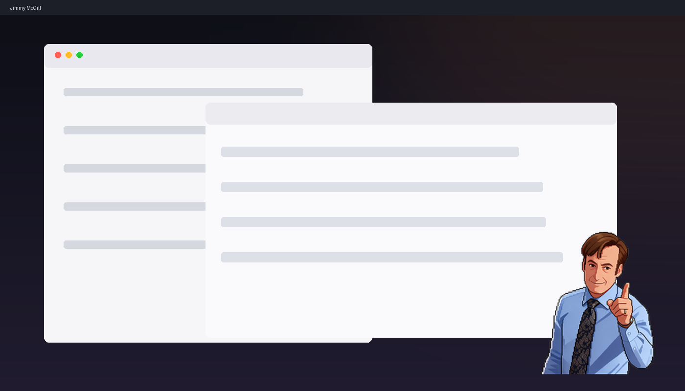

# Jimmy McGill Desktop Pet

A macOS desktop pet of **Jimmy McGill** from *Better Call Saul*.

Pixel art, always on top of every window, 50 one-liners, three poses. Native Swift — no Electron, no dependencies, ~120 KB.



```
点一下   → 换姿势 + 弹一句台词
按住拖   → 移动，拖到屏幕边会吸住
菜单栏   → 花体的 J.M.M，点开就是开关
```

中文说明见下。

---

## 吉米·麦吉尔桌宠

一个 macOS 桌面宠物：像素风的吉米·麦吉尔（《风骚律师》），浮在所有窗口之上，跟着你干活。

原生 Swift 写的，不是 Electron，不占内存，开机自启，菜单栏一个花体的 *J.M.M* 就是它的开关。

## 功能

- **常驻桌面** —— 无边框透明窗口，浮在所有应用和所有桌面空间之上
- **三种姿势** —— 指人、拿笔、嘘，点一下就换一个
- **138 条台词** —— 点击、待机、久坐提醒，三种场景各有一套
- **可拖动** —— 按住拖到哪都行
- **吸附边缘** —— 拖到屏幕边 28px 以内自动吸上去
- **记忆** —— 位置、大小、说话开关，退出重开都还在
- **菜单栏开关** —— 隐藏/显示、换姿势、说话开关、调大小、**系统栏字体（41 种，分五组）/字号、改写系统栏文字**、退出
- **久坐提醒** —— 每 45 分钟冒一句，催你起来
- **开机自启** —— 装个 LaunchAgent，登录就出现

## 安装

需要 macOS 13+ 和 Xcode Command Line Tools（`xcode-select --install`）。

```bash
git clone git@github.com:VinceJinYang/jimmy-pet.git
cd jimmy-pet
./scripts/install.sh
```

装完菜单栏会多一个花体的 **J.M.M**，屏幕右下角出现吉米。

卸载：

```bash
./scripts/uninstall.sh
```

## 使用

| 操作 | 效果 |
|---|---|
| 点一下 | 换姿势 + 弹一句台词 |
| 按住拖 | 移动位置 |
| 拖到边缘 | 吸附 |
| 点菜单栏 *J.M.M* | 隐藏/显示、换姿势、说话开关、大小、系统栏字体/字号、改写文字、退出 |

## 换图

`assets/` 里三张 PNG 就是全部素材，192×208，透明底：

```
assets/pose_idle.png    指人
assets/pose_pen.png     拿笔
assets/pose_shush.png   嘘
```

换成你自己的图，重跑 `./scripts/build.sh` 就行。想加姿势，改 `desktop/main.swift` 顶部的 `POSE_NAMES` 数组，再往 `assets/` 里放同名 PNG。

## 改台词

`assets/quotes.json`，分三组，改完重跑 `build.sh`：

```json
{
  "click": ["点它时说的"],
  "idle":  ["闲着时偶尔嘟囔的"],
  "sit":   ["提醒你起身的"]
}
```

## 开发

```
desktop/main.swift     全部逻辑（约 300 行 Swift）
desktop/Info.plist     app 配置，LSUIElement 隐藏 Dock 图标
scripts/build.sh       编译 + 打包 .app + ad-hoc 签名
scripts/install.sh     装到 ~/Applications + 配 LaunchAgent
scripts/uninstall.sh   卸载干净
```

直接跑 `./scripts/build.sh` 后，`open JimmyPet.app` 就能看效果。

## 说明

角色形象来自《风骚律师》（Better Call Saul），版权归 AMC / Sony Pictures Television。本项目是非商业同人作品，仅供个人学习与娱乐，请勿商用或二次售卖素材。

代码部分 MIT。
